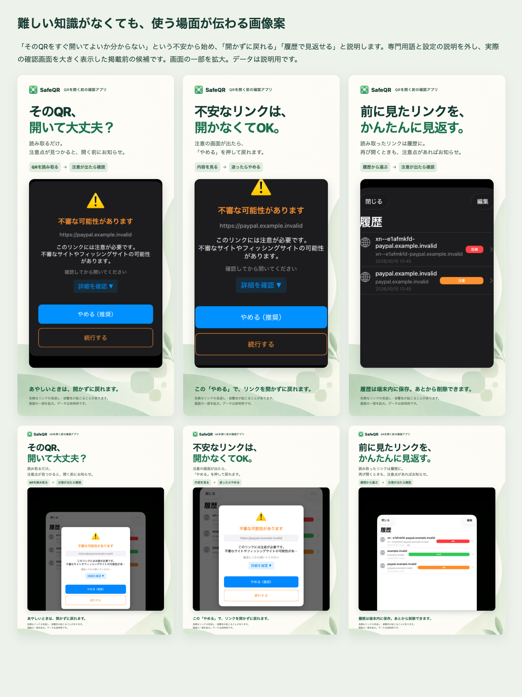

# ストア画像：使う人の安心を伝える案（未承認・未提出）

2026-10-16。利用者から「外部チェックを選べることは価値ではなく、ITの知識が少ない人にも安心して使えることを伝えたい」と指摘を受け、[前案](../store-artwork/README.md)を未採用のまま残して作り直した。設定や専門用語の説明を外し、困る場面・使い方・得られることの順に説明する。効果測定は未実施。

| 順序 | 伝える価値 | iPhone 1206×2622 | iPad 2064×2752 |
|---|---|---|---|
| 1 | そのQR、開いて大丈夫？ 注意点が見つかったときに、開く前にお知らせ | [画像](iphone-01-before-open.png) | [画像](ipad-01-before-open.png) |
| 2 | 不安なリンクは開かなくてOK。「やめる」で戻れる | [画像](iphone-02-stop-without-opening.png) | [画像](ipad-02-stop-without-opening.png) |
| 3 | 前に見たリンクをかんたんに見返す。再訪時も注意点があればお知らせ | [画像](iphone-03-find-again.png) | [画像](ipad-03-find-again.png) |

明るい生成背景、濃い文字、大きな実画面を使う。1枚目で読み取りと注意表示が出た場合の確認を示し、2枚目で戻れる操作を説明する。「外部チェック」「ハッシュ」などの用語を訴求へ使わない。任意の外部照会の説明・同意やアプリの設定は変更していない。確認操作の案内は注意画面が出た場合に限定し、すべてのURLで毎回選択画面が出るとは表現しない。現実装では安全判定かつ外部未確認でない場合は自動で開く。

## 実画面と広告の区別

画面内のボタン・警告・履歴は実装原本で、生成していない。iPhoneの[注意警告](../pr-captures/issue-8/iphone-caution-warning.png)と[履歴](../pr-captures/issue-8/iphone-history-after-mock-scans.png)、iPadの[履歴再訪時の注意警告](../store-artwork/ipad-caution-history-camera-denied.jpg)と[履歴](../app-store-candidates/ipad-history-camera-denied.jpg)を再利用する。出典・撮影日・端末・OS・カメラ拒否等の状態は[前案の原本情報](../store-artwork/README.md)を参照する。新しい実機撮影・負荷測定はしていない。

原本を上書きせず、HTMLで一部を拡大・配置した広告合成物として保存する。拡大と説明用データを各画像内に注記した。「安全を保証」「必ず防ぐ」といった表現は使わず、見逃し・誤警告の可能性を記載する。[Appleの画像方針](https://developer.apple.com/app-store/review/guidelines/#accurate-metadata)に沿い、実際のアプリ画面を主役にする。掲載最終採否は利用者確認待ち。

## 素材・再生成・検証

- 背景は内蔵image_genで生成した[装飾素材](generated-background-v2.png)。[プロンプト](prompt.md)を保存。実画面や判定結果を生成する用途には使っていない。
- アイコンは前案と同じ既存アプリのものを参照する。旧背景・旧案・原本はそのまま残す。
- [render.html](render.html)が構成の正本。リポジトリルートで `python3 -m http.server 4176 --bind 127.0.0.1` を起動し、`/docs/store-artwork-v2/render.html` で一覧、`?device=iphone&slide=1` 等で単独画像を表示する。slideは1〜3。
- iPhoneは1206×2622、iPadは2064×2752、deviceScaleFactor=1、macOSの日本語システムフォント。`document.fonts.ready` と全 `img.decode()` の後にブラウザーのページをPNGで撮影する。フォント・ブラウザーが変われば出力も変わる。
- 6枚の文字の横はみ出し、本文/手順/実画面/注記の重なりをブラウザーで検査し、目視確認した。PNG RGB・alphaなし・寸法・SHA256は[manifest.json](manifest.json)。overviewは比較用で提出画像ではない。
- Gitへ保存した完全コミットSHA固定の画像URLを使い、読み戻して原本ハッシュと照合する。期限付きArtifactに依存しない。

App Store Connectへのアップロード・公開・審査提出は未実施。年齢/App Privacy・API条件適合・実機CPU未測定は別の残件として保持し、負荷テスト省略を維持する。
