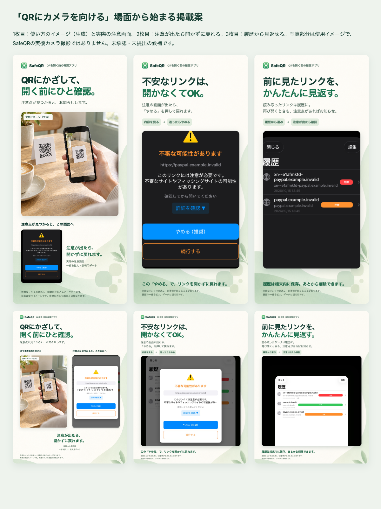

# QRにカメラを向ける場面から始まる掲載画像（利用者採用済み・ストア未提出）

2026-10-16。利用者から、カメラを開いた画面やQRを読み込む使用イメージがあると分かりやすい、との提案を受けた。実際の操作が想像できる導入画像を加え、「QRにスマホを向ける→注意点が見つかるとお知らせ→注意が出たら開かず戻れる」の流れを見せる。

2026-10-16の利用者回答「ok」により、下表の6枚と「QRにかざす → 注意が出たら戻る → 履歴を見返す」の掲載順・画像内コピーを採用した。確認記録は[Issue #8](https://github.com/tashua314/safe-qr/issues/8)。画像自体は変更していない。以下の一覧画像とrender.htmlの「未承認」は作成時点の表示で、最新の採用状態は本文とmanifest.jsonを正とする。

| 順序 | 内容 | iPhone 1206×2622 | iPad 2064×2752 |
|---|---|---|---|
| 1 | QRにかざす使用イメージ＋実際の注意画面 | [新案](iphone-01-camera-story.png) | [新案](ipad-01-camera-story.png) |
| 2 | 注意の画面が出たら「やめる」で戻れる | [既存案を再利用](../store-artwork-v2/iphone-02-stop-without-opening.png) | [既存案を再利用](../store-artwork-v2/ipad-02-stop-without-opening.png) |
| 3 | 履歴から見返す。注意点があればお知らせ | [既存案を再利用](../store-artwork-v2/iphone-03-find-again.png) | [既存案を再利用](../store-artwork-v2/ipad-03-find-again.png) |

## 写真と実画面の区別

写真部分は内蔵image_genで作った[使用イメージ](qr-scanning-usage-generated.png)。実機撮影・SafeQRの実際のカメラ画面ではない。写真内にSafeQRのUI・判定結果・安全を示す印を生成していない。「使用イメージ（生成）」と、実際のカメラ画面とは異なる旨を画像内に明記する。QR模様は撮影場面を伝える装飾で、アプリの検証用URLのQRとして使わない。

同じ画像に実際の注意画面も掲載する。iPhone版は[実装原本](../pr-captures/issue-8/iphone-caution-warning.png)、iPad版は[iPad実装原本](../store-artwork/ipad-caution-history-camera-denied.jpg)の一部をHTMLで拡大・配置したもの。カメラ画面を生成して実装のキャプチャに見せかける処理はしていない。状態・撮影環境は[原本情報](../store-artwork/README.md)を参照する。既存のSimulatorスキャン画像にはテストUIが写るため掲載しない。

「注意点が見つかると」「注意が出たら」という条件を残す。すべてのURLで必ず警告・選択画面が出るとは案内せず、見逃し・誤警告の可能性を注記する。原本、前案、アプリの挙動は変更していない。

[Appleの画像方針2.3.3](https://developer.apple.com/app-store/review/guidelines/#accurate-metadata)は実際のアプリ使用画面を求めているため、生成写真だけのポスターにせず、実画面を併記する。掲載画像と掲載順は利用者確認済みだが、これは申請文全体の確認やAppleによる審査承認を示さない。

## 素材と再出力

- [prompt.md](prompt.md)：内蔵image_genへの新規生成プロンプト。写真を生成した後、見出し・ラベル・実画面をHTMLで配置した。
- 背景・アイコンは既存案を参照。元画像を上書きしていない。実機操作・新規カメラ撮影・負荷テストはしていない。
- [render.html](render.html)を、リポジトリルートの `python3 -m http.server 4176 --bind 127.0.0.1` で表示する。単独画像は `/docs/store-artwork-v3/render.html?device=iphone` または `device=ipad`。クエリなしで6枚の構成案を表示する。
- deviceScaleFactor=1、macOSの日本語システムフォント、上表のviewport。`document.fonts.ready` と全 `img.decode()` の完了後にページをPNG保存する。フォント/ブラウザーが違えば出力も変わる。
- [manifest.json](manifest.json)に新規素材/導入画像/一覧と、再利用した4枚の寸法・alpha・SHA256を記録。提出候補6枚はPNG RGB・alphaなし。文字の横はみ出し、要素の重なりと写り込みを確認する。
- Gitの完全コミットSHA固定画像URLを使い、読み戻して原本と照合する。期限付きArtifactは参照先にしない。

画像6枚と掲載順は利用者採用済み。App Store Connectへの入力・アップロード・審査提出は未実施。年齢/App Privacy・実機CPU等の残件は引き続き別途管理する。非商用用途の確認は[申請回答案](../app-store-questionnaire-draft.md)を参照。負荷テスト省略の指示を維持する。
