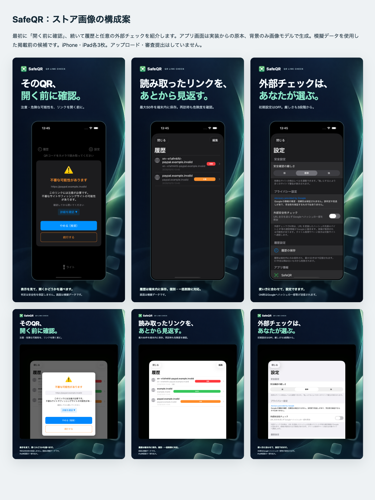

# ストア画像の新しい構成案（未承認・未提出）

2026-10-16。利用者から「原本4枚のままが最適か、画像モデルも使って魅力を伝えたい」と要望を受け、iPhone・iPad各3枚の案を作成した。従来の4枚は撮影原本として残し、この構成案の最終採否は利用者確認待ち。効果測定をしていないため「最適」「転換率が上がる」とは断定しない。

## 掲載順の案

| 順序 | 伝えること | iPhone 1206×2622 | iPad 2064×2752 |
|---|---|---|---|
| 1 | そのQR、開く前に確認。警告を見て開くか選ぶ | [画像](iphone-01-check-before-open.png) | [画像](ipad-01-check-before-open.png) |
| 2 | 読み取ったリンクを、あとから見返す。最大50件を端末内に保存 | [画像](iphone-02-local-history.png) | [画像](ipad-02-local-history.png) |
| 3 | 外部チェックは、あなたが選ぶ。既定OFF・厳しさ3段階 | [画像](iphone-03-optional-check.png) | [画像](ipad-03-optional-check.png) |

背景だけを内蔵image_genで生成し、日本語コピーと実際のアプリ画面は[render.html](render.html)で組み合わせた。アプリ画面内の文字、警告、ボタン、判定結果は生成していない。iPadのシート表示が小さくなるため実画面の一部を拡大し、各画像にその旨を注記した。実機のカメラ映像や実利用履歴は使っていない。

「安全を保証する」「すべて検知する」などの表現は使わず、警告画像には判定の限界を記載した。[Apple Review Guidelines 2.3.3](https://developer.apple.com/app-store/review/guidelines/#accurate-metadata)に沿い、装飾だけでなく実際のアプリ利用画面を主役にする。

## 原本と生成素材

- iPhone：既存の[注意警告](../pr-captures/issue-8/iphone-caution-warning.png)・[履歴](../pr-captures/issue-8/iphone-history-after-mock-scans.png)・[設定](../pr-captures/issue-8/iphone-settings.png)。2026-10-15、iPhone16Pro Simulator / iOS26.5。撮影状態は[QA記録](../pr-captures/issue-8/README.md)を参照。新規撮影とは区別する。
- iPad：既存の[履歴](../app-store-candidates/ipad-history-camera-denied.jpg)・[設定](../app-store-candidates/ipad-settings-camera-denied.jpg)と、新規の[履歴再訪時の注意警告](ipad-caution-history-camera-denied.jpg)。iPad Pro13 M4 Simulator / iPadOS26.5 (23F77)。新規原本はAPIキーなしのRelease、カメラ拒否・外部OFF・既存の`.invalid`模擬履歴から撮影。対象サイトを開かずキャンセルし、撮影後に専用Simulatorのカメラ権限をgrant・起動状態をShutdownへ戻した。アプリコードは `b3c7b9f5afbff22df93c85bcdf88a99f9ee37f16` と同じ。
- [生成背景](generated-background-v1.png)：装飾専用。実画面や判定結果ではない。[使用プロンプト](prompt.md)を保存。
- [アイコン](app-icon.png)：既存アプリの180pxアイコンのコピー。新しいロゴは作っていない。
- [manifest.json](manifest.json)：原本・合成画像の寸法・SHA256・alpha・状態。提出候補6枚はPNG RGB、alphaなし。[Apple画像仕様](https://developer.apple.com/help/app-store-connect/reference/app-information/screenshot-specifications/)の許容寸法と照合した。overviewは比較用で提出画像ではない。

## 再出力

リポジトリのルートで `python3 -m http.server 4176 --bind 127.0.0.1` を起動し、`/docs/store-artwork/render.html` を開くと6枚の一覧を表示する。単独出力は `?device=iphone&slide=1` など（slideは1〜3）。iPhoneは1206×2622、iPadは2064×2752のviewport、deviceScaleFactor=1、macOSの日本語システムフォントで作成した。ブラウザーで `document.fonts.ready` と各 `img.decode()` の完了後にページをPNGで撮影する。ブラウザー・フォントが違えば出力ハッシュは変わるため、再出力後は寸法・alpha・文字切れ・ハッシュを再確認する。

HTML内で画面を拡大・配置しているが、元のスクリーンショット自体は上書きしていない。最終画像はUI検証用の原本とは別の広告合成物として扱う。Gitへ保存し、PRでは完全コミットSHA固定の画像URLを使う。期限付きArtifactに依存しない。

## 残る確認

利用者が画像・コピー・順序を確認する。App Store Connectへのアップロード・公開・審査提出は未実施。年齢/App Privacy・API条件適合・実機CPU未測定を、この画像準備で完了としない。負荷テスト省略の指示を維持する。
